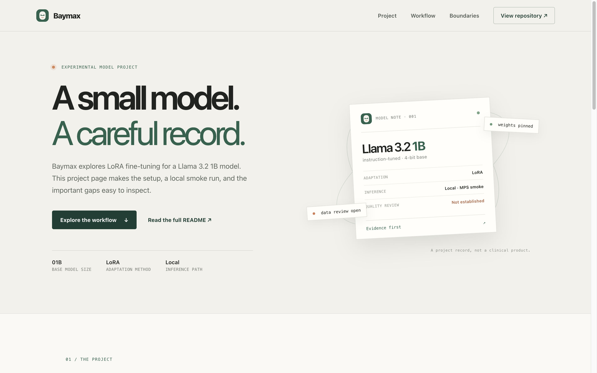

<p align="center">
  
</p>

<h1 align="center">Baymax — Llama 3.2 Fine-Tuning Experiment</h1>

<p align="center"><strong>An experimental LoRA project with a verifiable local inference record and clear limits.</strong></p>

<p align="center">
  <a href="https://github.com/ayushcodes13/Baymax"></a>
  <a href="https://github.com/ayushcodes13/Baymax/actions/workflows/verification.yml"></a>
  <a href="https://baymax-web-git-baymax-vercel-preview-devayush-personal.vercel.app/"></a>
  <a href="./LICENSE"></a>
  
  
</p>

<p align="center">
  
</p>

> **Not for medical use.** This experimental model may generate inaccurate, unsafe, or unsupported health claims. It does not diagnose, treat, or replace a qualified health professional.

**Vercel preview:** [Open the static project page](https://baymax-web-git-baymax-vercel-preview-devayush-personal.vercel.app/). This is a preview deployment of `web/`; it presents the project and does not host or run the fine-tuned model. No production deployment is configured.

Baymax is a fine-tuning project for a Llama 3.2 1B model using 4-bit loading
and LoRA. The training workflow is recorded in
[`finetuning_llama.ipynb`](./finetuning_llama.ipynb). Public Hugging Face
artifacts are available as [LoRA weights](https://huggingface.co/ayoozzzz/baymax-llama-1b-finetuned-weights),
[a Transformers model](https://huggingface.co/ayoozzzz/baymax-llama-1b-finetuned),
and [a GGUF build](https://huggingface.co/ayoozzzz/baymax-llama-1b-gguf).

This repository also contains a separate Flask + LangChain RAG prototype backed
by Pinecone and Groq. That app is not the Baymax fine-tuned model and does not
load or serve its weights. The RAG prototype is documented below as a separate,
legacy experiment.

> **Scope:** This is a wellbeing conversation prototype, **not** a medical
> product. It does not diagnose, treat, or replace consultation with a
> qualified health professional. The LLM may produce inaccurate or
> outdated information — always verify with authoritative sources.

---

## Fine-tuning project

The notebook loads the 4-bit base model recorded by the published adapter,
`unsloth/llama-3.2-1b-instruct-unsloth-bnb-4bit`. Its Hub revision and training
parameters live in [`training_config.json`](./training_config.json), which the
notebook reads. The public Hub repositories show that model artifacts were
uploaded. Their presence does not establish that the training run is
reproducible, that those artifacts match a new run, or that the model has been
clinically or otherwise independently evaluated.
The adapter and full-model Hugging Face cards still contain generic template
placeholders for licensing, training data, procedure, and evaluation. The GGUF
repository labels its artifact MIT. Before further redistribution, review its
metadata and name against the [Llama 3.2 Community License](https://github.com/meta-llama/llama-models/blob/main/models/llama3_2/LICENSE).
That license specifies a Llama-prefixed name for distributed fine-tunes, a
copy of the agreement, and “Built with Llama” attribution. The current Hub
repo names start with `baymax-`; this checkout does not change the public Hub
artifacts.

### Fine-tuning status and reproducibility

Treat the notebook as an experimental record, not a fully reproducible training
recipe or a validated medical model. It depends on a hosted CUDA GPU runtime,
and package versions are not pinned. Once data review gates are cleared, it
will deterministically reserve 10% of the selected sample for validation loss.
This is an internal training diagnostic, not an independently reviewed
medical evaluation set. Hub authentication is not needed to load the public
base, and publishing is not part of the notebook. Earlier saved notebook
outputs were removed because they included authentication material and
personal experiment data. Never paste tokens into cells.

The model base is pinned for future runs to revision
`8eb7999dc1d92775e7b5f75754a29c3fbdb32723`. The published adapter records the
same base model ID but does not record its base revision, so this does not prove
that the existing uploaded weights used this exact commit.
The data input is pinned to immutable dataset revision
`d225c93b6430ec425f7264975ee23f44a94620fd`. The notebook expects the
`Description`, `Doctor`, `Patient`, and `Status` columns, then proposes using
`Description` as input and `Doctor` as the target. That semantic mapping has not
been independently reviewed, so it has its own fail-closed gate. The dataset
card has no license metadata; provenance, usage rights, and sensitive-data
handling also remain unresolved. Public availability does not establish
permission to train on it. The notebook stops before installing packages,
loading model weights, or downloading dataset rows while either gate is set.

The model and dataset revisions, LoRA settings, deterministic sample, and
training parameters are captured in a manifest consumed by the notebook. Once
the review gates are cleared, the notebook writes an ignored local
`artifacts/baymax-lora/run_manifest.json` with the source commit, runtime and
package versions, CUDA/GPU details, input revisions, configuration, and status.
It does not record secrets or dataset rows. This makes each attempted run
auditable, but does not replace a pinned environment or an independently
reviewed evaluation set. The internal split comes from the same dataset; its
loss does not establish medical accuracy, safety, or generalization. Unsloth
installation guidance selects dependencies for the chosen Python, PyTorch, and
CUDA combination; this repository does not claim a tested lock for an
unspecified GPU runtime. See the
[official Unsloth installation guide](https://unsloth.ai/docs/get-started/install/pip-install).
Resolve the data gates, choose and validate a concrete runtime, lock its package
versions, independently review an evaluation set, and record the resulting
adapter revision before claiming a reproducible checkpoint.

The notebook requires a CUDA GPU, but this checkout has no verified CUDA
runtime. It also requires the repository and its Python virtual environment to
remain under `/Volumes/PEN DRIVE/Project Work/ayushcodes13/Baymax`; the first
cell stops before installation or downloads if either path is elsewhere.
Standard Colab sessions cannot access the Mac's mounted PEN DRIVE, so they are
blocked by this check. Package caches, dataset caches, temporary files, and
training outputs stay under the checkout when a compliant runtime is available.
The notebook also stops until the dataset-rights and schema-mapping gates are
cleared after review.

### Local inference smoke for the published full model

This separate path tests only whether the pinned public Transformers model can
load and generate a short, fictional greeting. It does not train the model or
evaluate medical quality, safety, or accuracy. The model files are about 2.5 GB
and will be cached under `.cache/huggingface` on the PEN DRIVE. The Python
3.9 environment, package cache, model cache, and smoke manifest are also kept
under this checkout. A small helper removes AppleDouble `._*` files that
macOS writes into the PEN DRIVE's FAT filesystem and that Python may misread
as `.pth` files. Keep all installation temporary files on the drive:

```bash
mkdir -p .tmp .cache/pip .cache/huggingface .cache/xdg
export TMPDIR="$PWD/.tmp/"
export PIP_CACHE_DIR="$PWD/.cache/pip"
export HF_HOME="$PWD/.cache/huggingface"
export XDG_CACHE_HOME="$PWD/.cache/xdg"
/usr/bin/python3 -m venv .venv-inference
/usr/bin/python3 scripts/clean_pendrive_metadata.py
.venv-inference/bin/python -m pip install --require-hashes -r requirements-inference.lock
/usr/bin/python3 scripts/clean_pendrive_metadata.py
```

The script uses the pinned `ayoozzzz/baymax-llama-1b-finetuned` revision in
[`inference_config.json`](./inference_config.json) and needs no Hugging Face token.
Each new inference writes a unique `.tmp/offline-inference-<32-hex-run-ID>.manifest.json`
with version and source hashes, but without the generated prompt or output.
Use the wrapper below to capture the matching log and exit record. Directly
running `scripts/inference_smoke.py` generates a manifest but no paired
log/exit evidence, so it cannot independently pass the recorded-run verifier.

**No-download verifier self-test:** The verifier and its synthetic-fixture
self-test are tracked in this repository. From a fresh clone on the PEN DRIVE,
run the self-test before installing packages or downloading model weights:

```bash
mkdir -p .tmp
export TMPDIR="$PWD/.tmp/"
export PYTHONDONTWRITEBYTECODE=1
/usr/bin/python3 -B scripts/self_test_verification.py
```

A self-test PASS means the verifier and wrapper reject synthetic failure cases;
it **does not** run Baymax, validate weights, reproduce a historical inference,
or establish medical safety. The self-test cleans up its temporary fixture
directories under `.tmp`. It requires no `.venv-inference`, `.cache`,
network connection, or model weights.

For an **actual offline model-generation check**, after the pinned dependencies
and model files have been cached on the PEN DRIVE, run from this repository.
This executes the model locally; it is not part of the source-only self-test:

```bash
bash scripts/run_offline_inference.sh
# Set this to the run ID in the wrapper's printed .tmp/offline-inference-<run-ID>.log path:
run_id="<run-ID-from-wrapper>"
.venv-inference/bin/python scripts/verify_inference_manifest.py \
  --run-log ".tmp/offline-inference-${run_id}.log" \
  --exit-status ".tmp/offline-inference-${run_id}.exit"
```

The wrapper disables Hugging Face downloads, points temporary and package
caches at this checkout, and creates a unique `.log`, `.exit` JSON, and
`.manifest.json` for each invocation. The manifest and final marked result
frame contain the same random run ID. The verifier requires the log and exit
record with matching filenames and IDs, then checks the matching manifest's
SHA-256, zero exit status, pinned model revision, nonempty generated output,
and current source file hashes. It rejects stale manifests even when two
runs generate identical text. The wrapper exits with an error if the log,
manifest, or exit evidence cannot be written. The ignored local log contains the
fictional generated greeting; avoid using private prompts or sharing logs.
If a run is interrupted, inspect the log, exit record and manifest
timestamp before starting it again; corroborating a previous successful run
does not establish that a later run succeeded. Always select the matching
records from the run being assessed. The offline wrapper requires a populated
local cache. The manifest verifier checks recorded run evidence; it does not
assess the semantic correctness, clinical safety, or quality of the generated
reply. MPS first-load latency can be substantial on macOS.

**Recorded local smoke evidence (16 October 2026):** On macOS MPS, the pinned
public model generated text and the current manifest verifier accepted the
matching log, exit record, and manifest. The run artifacts are local ignored
files and are not part of a fresh clone. The response included the unsupported
claim that Baymax was “a great tool for monitoring your health and well being.”
This is a concrete safety failure. The verifier confirms that the recorded
files match the run protocol; it does not validate the output. Do not present
this smoke run as evidence of health monitoring capability, medical accuracy,
safety, or clinical competence. A separate older 14 October run uses the
legacy evidence format and is not accepted by the current verifier.

## Separate legacy experiment: retrieval web app

This Flask application uses a Pinecone retriever and a Groq generator. It is an
independent prototype and is not how the fine-tuned Baymax model is served.

### Architecture

```
User → Flask web UI (chat.html)
              ↓
        /get endpoint
              ↓
   RAG chain (LangChain)
      ├─ Retriever: Pinecone vector store (similarity search, k=3)
      └─ Generator: ChatGroq (llama3-70b-8192)
              ↓
        Retrieved context + reply
```

## Quick start

### 1. Clone & create a virtual environment

```bash
git clone https://github.com/ayushcodes13/Baymax.git
cd Baymax
python3 -m venv .venv
source .venv/bin/activate
```

### 2. Install dependencies

Only the runtime requirements are needed for the web app:

```bash
pip install -r requirements.txt
```

For experimental audio/vision/model modules (STT, TTS, BioGPT):

```bash
pip install -r requirements-research.txt
```

### 3. Configure environment

```bash
cp .env.example .env
# Edit .env and fill in your PINECONE_API_KEY and GROQ_API_KEY
```

### 4. Build the vector index

Place your PDF documents in `data/` (or specify another directory):

```bash
mkdir -p data
# copy your PDFs into data/
python3 store_index.py --data-dir data --index-name baymax-index
```

This will:
- Load all PDFs from the directory
- Split them into 500-token chunks
- Embed them with `sentence-transformers/all-MiniLM-L6-v2`
- Create or update the Pinecone index `baymax-index`

### 5. Run the app

```bash
python3 app.py
```

Open `http://localhost:8080` in your browser.

---

## Project structure

| File | Description |
|------|-------------|
| `app.py` | Flask server and RAG chain entry point |
| `store_index.py` | Builds the Pinecone vector index from PDFs |
| `src/helper.py` | PDF loading, text splitting, embedding setup |
| `src/prompt.py` | System prompt with wellbeing boundaries |
| `templates/chat.html` | Web chat UI |
| `static/style.css` | Chat UI styling |
| `convert_pdf_to_txt.py` | Utility to batch-convert PDFs to text |
| `requirements.txt` | Runtime dependencies (Flask, LangChain, Pinecone, Groq) |
| `requirements-research.txt` | Heavy optional deps (torch, whisper, vosk, pygame) |

## Data handling

- API keys are loaded from environment variables / `.env` and are never
  committed to version control.
- PDF documents in `data/` are read locally by `store_index.py`; their text is
  embedded and the resulting vectors and source metadata are uploaded to Pinecone.
  Check document rights and Pinecone's current data handling before indexing.
- Chat messages are sent to Groq for reply generation. Do not enter
  sensitive personal or health information.
- No chat history is persisted to a database.
- The fine-tuning notebook downloads its base model from Hugging Face and is
  configured to use a pinned dataset revision after the rights gate is cleared.
  Its package, Hugging Face, dataset, temporary, and output paths are configured
  beneath the notebook's working directory. The notebook does not start an
  experiment tracker or publish artifacts.

## Safety & limitations

- This prototype is **not** therapy, diagnosis, medical advice, or a
  clinical service.
- The LLM generates responses from a general-purpose model. Content may be
  inaccurate, outdated, or hallucinated.
- Retrieved documents inform the answer but are not independently verified.
- There is no authentication, audit logging, or production privacy review.

## License

Apache 2.0. See [LICENSE](./LICENSE).
